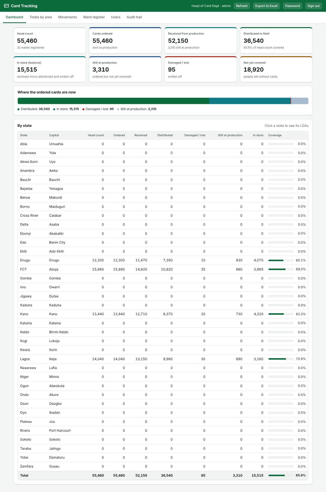

# Card Tracking

A free, simple web app for a card department to account for every card from production to the field across Nigeria: **State › LGA › Ward › Community**, with head count and movements kept per ward and rolling up to national totals.

## Features
- Dashboard with national totals, where the cards are now, and all 36 states + FCT (with capitals)
- Location list of 33 states, 382 LGAs, 2,184 wards and 44,161 communities (`data/State-Ward.csv`)
- Drill-down totals by State, LGA and Ward: head count, ordered, received, distributed, damaged/lost, still at production, in store, coverage %
- Movements log: Sent to Production, Received from Production, Distributed to Field, Damaged / Lost, each with date, reference, ward, quantity, officer and approver
- Balance checks stop entries that don't add up (e.g. distributing more than is in store)
- Roles: **admin** (records & approves, manages wards/users), **officer** (records; needs approval), **viewer** (view & export)
- Nothing is deleted: wrong entries are voided with a reason; full audit trail of sign-ins and changes
- Export to Excel for reconciliation; import wards and past movements from Excel

## How it runs
Google Apps Script web app attached to a private Google Sheet (the database). No server or hosting costs. Staff sign in with app usernames and passwords; they don't need Google accounts.

| File | What it is |
|---|---|
| `Code.gs` | Server side: data, rules, logins, audit trail |
| `Index.html` | The web page the staff use |
| `Card_Tracking_Preview.html` | A preview copy that runs on your own computer: download it and double-click. Data stays in that browser. |
| `demo/` | The same demo split into separate files (`index.html`, `style.css`, `app.js`, `backend.js`) for putting on a website |
| `SETUP_GUIDE.md` | Step-by-step setup in plain language (about 15 minutes) |
| `data/State-Ward.csv` | The location list: state, LGA, ward and community, one community per row |
| `docs/Card_Tracking_Sample.xlsx` | The original sample workbook |

See **[SETUP_GUIDE.md](SETUP_GUIDE.md)** to put it online.
